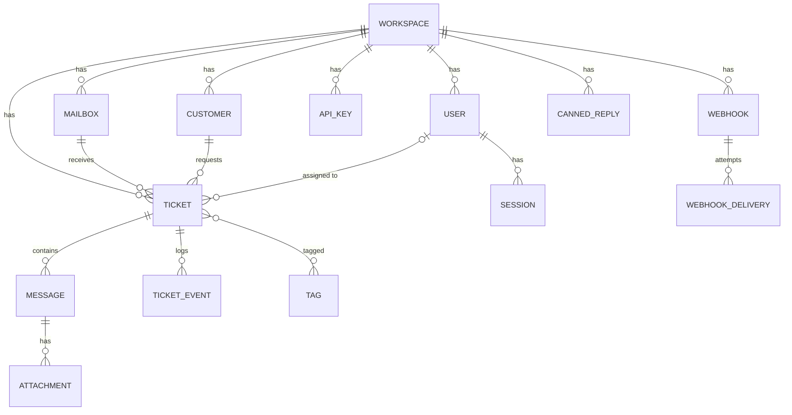
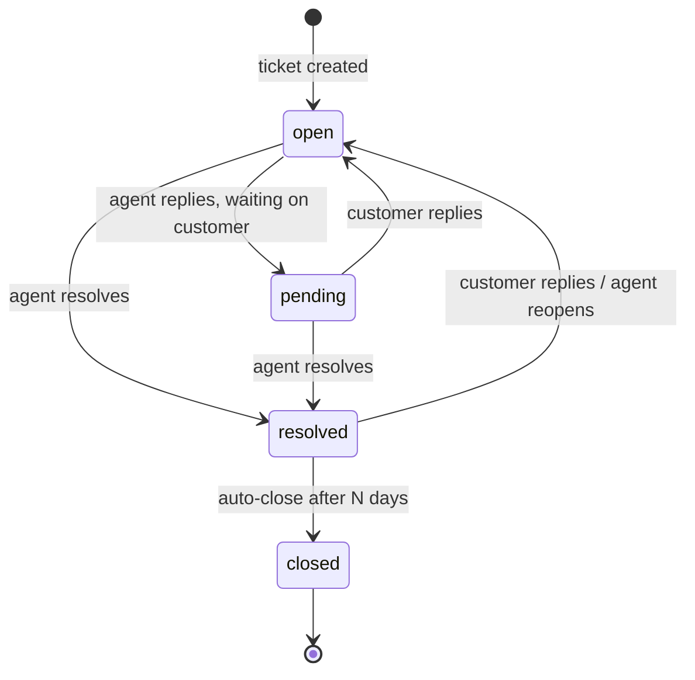

# Data Model

Conventions:

- Primary keys are UUIDs (v7 preferred for index locality) unless noted.
- Every tenant-owned table has `workspace_id`. Queries always filter on it.
- Timestamps are UTC, stored as `timestamptz`: `created_at`, `updated_at`.
- Soft delete (`deleted_at`) only where noted. Otherwise rows are retained or hard deleted explicitly.
- Enums are stored as text with a check constraint (easier to migrate than DB enums).

> Table and column names are the design target. Adapt to whatever Toasty's model syntax requires.
>
> Types are **logical**. The app targets SQLite first and PostgreSQL later (see [ADR-003](DECISIONS.md#adr-003-sqlite-first-postgresql-for-scale)). On SQLite: `uuid` → text, `timestamptz` → UTC text or integer, `jsonb` → JSON text, `text[]` → JSON array, `bool` → integer. Avoid features that exist in only one engine (partial indexes and `RETURNING` are fine in both).

## Entity relationship diagram

## Core tables (MVP)

### `workspaces`

| Column | Type | Notes |
|---|---|---|
| `id` | uuid PK | |
| `name` | text | |
| `slug` | text unique | |
| `next_ticket_number` | bigint | Used to allocate per-workspace ticket numbers |
| `created_at` | timestamptz | |

### `users` (staff)

| Column | Type | Notes |
|---|---|---|
| `id` | uuid PK | |
| `workspace_id` | uuid FK | |
| `email` | text | Unique per workspace, case-insensitive |
| `name` | text | |
| `password_hash` | text | Argon2id |
| `role` | text | `admin` \| `agent` |
| `is_active` | bool | Deactivated users keep history |
| `last_seen_at` | timestamptz null | |
| `created_at`, `updated_at` | timestamptz | |

### `sessions`

Backs Topcoat's session API: the framework issues and reads the cookie token, and the app persists its hash, the user, and the expiry. See [ARCHITECTURE.md](ARCHITECTURE.md#authentication).

| Column | Type | Notes |
|---|---|---|
| `id` | uuid PK | |
| `user_id` | uuid FK | |
| `token_hash` | text unique | Store a hash, never the raw token |
| `expires_at` | timestamptz | |
| `user_agent`, `ip` | text null | |
| `created_at` | timestamptz | |

### `mailboxes`

A support address the workspace receives mail on.

| Column | Type | Notes |
|---|---|---|
| `id` | uuid PK | |
| `workspace_id` | uuid FK | |
| `name` | text | Display name, e.g. "Acme Support" |
| `address` | text unique | e.g. `help@acme.com` |
| `signature` | text null | Appended to outbound replies |
| `is_default` | bool | Used by the web form |

### `customers`

| Column | Type | Notes |
|---|---|---|
| `id` | uuid PK | |
| `workspace_id` | uuid FK | |
| `email` | text | Lowercased. Unique per workspace |
| `name` | text null | |
| `notes` | text null | |
| `created_at`, `updated_at` | timestamptz | |

### `tickets`

| Column | Type | Notes |
|---|---|---|
| `id` | uuid PK | |
| `workspace_id` | uuid FK | |
| `number` | bigint | Human-friendly, sequential per workspace. Unique with `workspace_id` |
| `mailbox_id` | uuid FK | |
| `requester_id` | uuid FK → customers | |
| `assignee_id` | uuid FK → users, null | Null means unassigned |
| `subject` | text | |
| `status` | text | `open` \| `pending` \| `resolved` \| `closed` |
| `priority` | text | `low` \| `normal` \| `high` \| `urgent` (default `normal`) |
| `channel` | text | `web_form` \| `email` \| `api` |
| `first_response_at` | timestamptz null | First agent reply to customer |
| `resolved_at` | timestamptz null | |
| `last_activity_at` | timestamptz | Drives list ordering |
| `created_at`, `updated_at` | timestamptz | |

Indexes:

- `(workspace_id, number)` unique
- `(workspace_id, status, last_activity_at desc)`
- `(workspace_id, assignee_id, status)`
- `(workspace_id, requester_id)`

### `messages`

A single entry in the conversation thread.

| Column | Type | Notes |
|---|---|---|
| `id` | uuid PK | |
| `workspace_id` | uuid FK | |
| `ticket_id` | uuid FK | |
| `kind` | text | `customer` \| `agent` \| `note` \| `system` |
| `author_user_id` | uuid FK null | Set for `agent` and `note` |
| `author_customer_id` | uuid FK null | Set for `customer` |
| `body_text` | text | Plain text, always present |
| `body_html` | text null | **Sanitized** HTML, rendered view only |
| `email_message_id` | text null | RFC 5322 `Message-ID`. Unique per workspace when set (idempotency) |
| `in_reply_to` | text null | |
| `references` | text null | |
| `delivery_status` | text null | For outbound: `queued` \| `sent` \| `failed` |
| `created_at` | timestamptz | |

Indexes:

- `(ticket_id, created_at)`
- `(workspace_id, email_message_id)` unique where not null

### `attachments`

| Column | Type | Notes |
|---|---|---|
| `id` | uuid PK | |
| `workspace_id` | uuid FK | |
| `message_id` | uuid FK | |
| `filename` | text | Sanitized for display, never used as a storage path |
| `content_type` | text | |
| `size_bytes` | bigint | |
| `storage_key` | text | Opaque key (e.g. content hash or uuid) |
| `is_inline` | bool | Embedded images (`cid:`) |

### `ticket_events`

Append-only activity log. Powers the history panel and webhooks.

| Column | Type | Notes |
|---|---|---|
| `id` | uuid PK | |
| `workspace_id` | uuid FK | |
| `ticket_id` | uuid FK | |
| `actor_user_id` | uuid FK null | Null for customer or system |
| `kind` | text | `created`, `assigned`, `status_changed`, `priority_changed`, `message_added`, `tag_added`, ... |
| `data` | jsonb | Event details, e.g. `{ "from": "open", "to": "resolved" }` |
| `created_at` | timestamptz | |

### `jobs`

DB-backed background queue (see [ARCHITECTURE.md](ARCHITECTURE.md#background-jobs)).

| Column | Type | Notes |
|---|---|---|
| `id` | uuid PK | |
| `kind` | text | `send_email`, `deliver_webhook`, `process_inbound_email`, ... |
| `payload` | jsonb | |
| `status` | text | `queued` \| `running` \| `done` \| `failed` |
| `attempts` | int | |
| `run_at` | timestamptz | Supports delayed retries |
| `locked_at` | timestamptz null | |
| `last_error` | text null | |
| `created_at` | timestamptz | |

Index: `(status, run_at)`.

## Phase 2+ tables

### `tags` and `ticket_tags`

- `tags(id, workspace_id, name, color)`, unique `(workspace_id, name)`
- `ticket_tags(ticket_id, tag_id)`, composite PK

### `canned_replies`

`id, workspace_id, title, body, shortcut (unique per workspace), created_by, created_at, updated_at`

### Search index

Behind a `SearchIndex` trait: an FTS5 virtual table over ticket subject and message bodies on SQLite, or a `tsvector` column with a GIN index on PostgreSQL. Keep it in sync from the same code path that writes messages.

## Phase 3+ tables

### `api_keys`

| Column | Type | Notes |
|---|---|---|
| `id` | uuid PK | |
| `workspace_id` | uuid FK | |
| `name` | text | |
| `prefix` | text | First characters, shown in UI |
| `key_hash` | text | Hash of the full key. Raw key shown once at creation |
| `scopes` | text[] | e.g. `tickets:read`, `tickets:write` |
| `last_used_at` | timestamptz null | |
| `revoked_at` | timestamptz null | |

### `webhooks` and `webhook_deliveries`

- `webhooks(id, workspace_id, url, secret, event_types text[], is_active, created_at)`
- `webhook_deliveries(id, webhook_id, event_id, status, response_code, attempts, next_attempt_at, last_error, created_at)`

## Phase 4+ tables

### `sla_policies`

`id, workspace_id, name, first_response_minutes, resolution_minutes, priority_filter, business_hours jsonb`

Tickets gain `sla_policy_id`, `first_response_due_at`, `resolution_due_at`, and `sla_breached_at`.

### `automation_rules`

`id, workspace_id, name, trigger, conditions jsonb, actions jsonb, is_active, position`

## Ticket status state machine

Rules:

- A customer message on a `pending` or `resolved` ticket moves it to `open`.
- A customer message on a `closed` ticket **creates a new ticket** that references the old one (`related_ticket_id`, optional column).
- Status changes always write a `ticket_events` row.
- Only `agent`/`admin` roles can change status via UI or API.

## Invariants to enforce in code and tests

1. `tickets.number` is gapless-not-required but unique and monotonic per workspace.
2. A `messages` row of kind `customer` has `author_customer_id` set; `agent` and `note` have `author_user_id` set.
3. `body_html` is only ever written by the sanitizer.
4. An inbound email with an already-seen `email_message_id` is a no-op.
5. Deleting a user is a deactivation. Historical tickets and messages keep their author.
