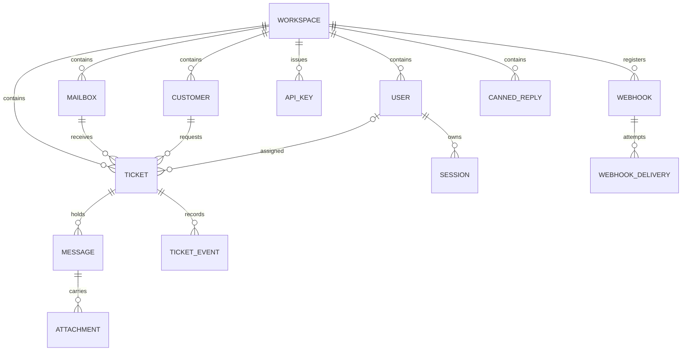
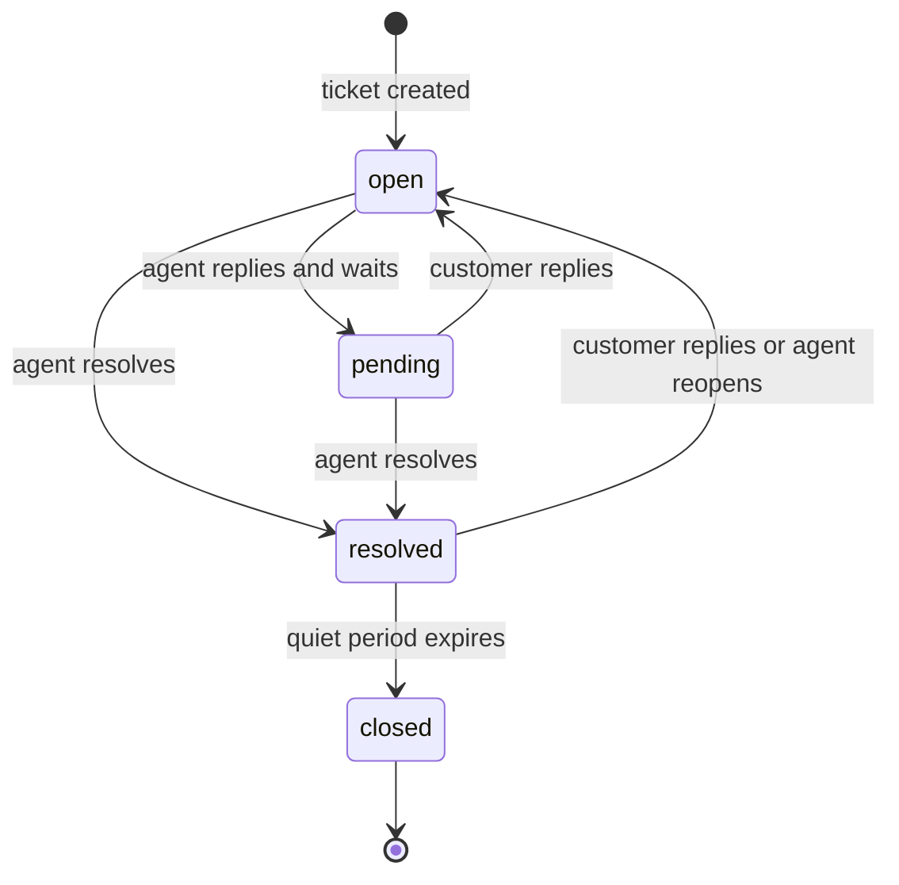

# Data model

Waypoint stores tenant data in relational tables. The model is designed for
SQLite first and kept portable enough for PostgreSQL. Logical types are listed
here; the storage layer maps them to each engine.

## Conventions

- Primary keys are UUIDs, preferably version 7 for index locality.
- Every tenant-owned row includes `workspace_id`.
- Timestamps are UTC and stored with timezone information.
- Enumerated values are text with a check constraint, which is easier to evolve
  than a database enum.
- Rows are retained unless the product explicitly defines deletion. Staff
  accounts are deactivated rather than removed.

## Relationships

## Tenancy and identity

### `workspaces`

| Column | Type | Notes |
|---|---|---|
| `id` | uuid | Primary key |
| `name` | text | Display name |
| `slug` | text | Unique, used in URLs and webhook payloads |
| `next_ticket_number` | bigint | Allocates ticket numbers per workspace |
| `created_at` | timestamptz | |

### `users`

Staff members. An email address is unique within a workspace and compared
case-insensitively.

| Column | Type | Notes |
|---|---|---|
| `id` | uuid | Primary key |
| `workspace_id` | uuid | Tenant key |
| `email` | text | Unique per workspace |
| `name` | text | |
| `password_hash` | text | Argon2id |
| `role` | text | `admin` or `agent` |
| `is_active` | bool | Deactivated users keep their history |
| `last_seen_at` | timestamptz | Nullable |
| `created_at`, `updated_at` | timestamptz | |

### `sessions`

The database side of a Topcoat session. The raw cookie token is never stored.

| Column | Type | Notes |
|---|---|---|
| `id` | uuid | Primary key |
| `user_id` | uuid | Session owner |
| `token_hash` | text | Unique hash of the cookie token |
| `expires_at` | timestamptz | Sliding expiry |
| `user_agent`, `ip` | text | Nullable request context |
| `created_at` | timestamptz | |

### `mailboxes`

A support address owned by a workspace.

| Column | Type | Notes |
|---|---|---|
| `id` | uuid | Primary key |
| `workspace_id` | uuid | Tenant key |
| `name` | text | For example, "Acme Support" |
| `address` | text | Unique support address |
| `signature` | text | Nullable, appended to replies |
| `is_default` | bool | Used by the public form |

## Customers and tickets

### `customers`

A person who has contacted the workspace. Customers do not have accounts.

| Column | Type | Notes |
|---|---|---|
| `id` | uuid | Primary key |
| `workspace_id` | uuid | Tenant key |
| `email` | text | Lowercase, unique per workspace |
| `name` | text | Nullable |
| `notes` | text | Nullable internal notes |
| `created_at`, `updated_at` | timestamptz | |

### `tickets`

| Column | Type | Notes |
|---|---|---|
| `id` | uuid | Primary key |
| `workspace_id` | uuid | Tenant key |
| `number` | bigint | Human-facing number, unique per workspace |
| `mailbox_id` | uuid | Receiving mailbox |
| `requester_id` | uuid | Customer who opened the ticket |
| `assignee_id` | uuid | Staff owner, nullable |
| `subject` | text | |
| `status` | text | `open`, `pending`, `resolved`, `closed` |
| `priority` | text | `low`, `normal`, `high`, `urgent` |
| `channel` | text | `web_form`, `email`, `api` |
| `first_response_at` | timestamptz | First agent reply, nullable |
| `resolved_at` | timestamptz | Nullable |
| `last_activity_at` | timestamptz | Queue ordering |
| `created_at`, `updated_at` | timestamptz | |

Indexes:

- `(workspace_id, number)` unique.
- `(workspace_id, status, last_activity_at desc)` for the main queue.
- `(workspace_id, assignee_id, status)` for personal views.
- `(workspace_id, requester_id)` for customer history.

Ticket numbers are sequential per workspace and never reused. They are
human-friendly, so access checks always include the workspace.

## Conversation

### `messages`

One entry in a ticket thread. A message is always plain text and may also carry
sanitized HTML.

| Column | Type | Notes |
|---|---|---|
| `id` | uuid | Primary key |
| `workspace_id` | uuid | Tenant key |
| `ticket_id` | uuid | Parent ticket |
| `kind` | text | `customer`, `agent`, `note`, `system` |
| `author_user_id` | uuid | Set for agent messages and notes |
| `author_customer_id` | uuid | Set for customer messages |
| `body_text` | text | Always present |
| `body_html` | text | Sanitized HTML for display |
| `email_message_id` | text | RFC 5322 identifier, nullable |
| `in_reply_to` | text | Nullable |
| `references` | text | Nullable |
| `delivery_status` | text | `queued`, `sent`, `failed` for outbound mail |
| `created_at` | timestamptz | |

Indexes:

- `(ticket_id, created_at)` for thread rendering.
- `(workspace_id, email_message_id)` unique where the identifier is present,
  used for inbound idempotency.

### `attachments`

| Column | Type | Notes |
|---|---|---|
| `id` | uuid | Primary key |
| `workspace_id` | uuid | Tenant key |
| `message_id` | uuid | Parent message |
| `filename` | text | Display name only |
| `content_type` | text | |
| `size_bytes` | bigint | |
| `storage_key` | text | Opaque key, never a user path |
| `is_inline` | bool | Embedded `cid:` images |

### `ticket_events`

Append-only activity log. It drives the history panel and webhook events.

| Column | Type | Notes |
|---|---|---|
| `id` | uuid | Primary key |
| `workspace_id` | uuid | Tenant key |
| `ticket_id` | uuid | Parent ticket |
| `actor_user_id` | uuid | Nullable for customer or system events |
| `kind` | text | `created`, `assigned`, `status_changed`, and similar |
| `data` | jsonb | Event-specific detail |
| `created_at` | timestamptz | |

## Operations

### `jobs`

The durable background queue.

| Column | Type | Notes |
|---|---|---|
| `id` | uuid | Primary key |
| `kind` | text | `send_email`, `process_inbound_email`, `deliver_webhook` |
| `payload` | jsonb | Job input |
| `status` | text | `queued`, `running`, `done`, `failed` |
| `attempts` | int | Retry counter |
| `run_at` | timestamptz | Supports delayed work |
| `locked_at` | timestamptz | Nullable claim timestamp |
| `last_error` | text | Nullable |
| `created_at` | timestamptz | |

The queue index is `(status, run_at)`.

## Later entities

These tables support features that are not part of the first usable product but
are accommodated by the current design.

- `tags` and `ticket_tags` for categorization.
- `canned_replies` for reusable responses and shortcuts.
- `api_keys` for scoped programmatic access.
- `webhooks` and `webhook_deliveries` for outbound integrations.
- `sla_policies` for response and resolution targets.
- `automation_rules` for trigger, condition, and action workflows.

## Ticket lifecycle

A customer message on a pending or resolved ticket returns it to open. A
customer message on a closed ticket starts a new ticket that can reference the
old one. Only staff can change status directly, and every transition records a
ticket event.

## Invariants

1. Ticket numbers are unique and monotonic within a workspace; gaps are allowed.
2. A customer message has a customer author; an agent message or note has a
   staff author.
3. HTML message bodies are written only by the sanitizer.
4. A previously stored `Message-ID` makes an inbound delivery a no-op.
5. Deactivating a user preserves their historical authorship.
6. Every tenant query filters by `workspace_id`.
